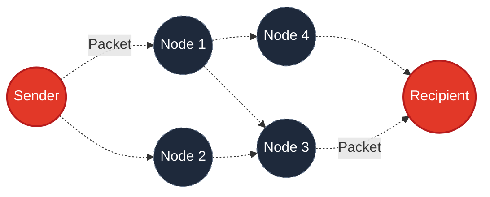

  

  
    
  <h1>Bridgefy App: Community Network Research</h1>
  
<b>Offline Communication • BLE Mesh Routing • Telemetry Project</b>

  
  
  
  
   
  <a href="https://bridgefy.me">🌐 Official Website</a> • 
  <a href="https://github.com/bridgefy">💻 GitHub Repository</a>

---

## 🌍 Global Impact & Purpose

This repository hosts the Android application for our **community-driven network research initiative**. Bridgefy's core technology has a proven track record of helping people stay connected when traditional networks fail.

> **Trusted by over 3 million users globally**, Bridgefy's offline messaging technology has been utilized during natural disasters, large-scale music festivals, and humanitarian crises. Our technology is recognized by global organizations for facilitating critical communication when Wi-Fi and cellular networks are down.

By using this application, you are directly contributing to network research. We collect essential telemetry (crash logs and routing metrics) to optimize decentralized communication algorithms for future crisis response.

---

## 📡 Technology: Multi-Hop BLE Mesh

The application relies on a decentralized, multi-hop network architecture. Instead of connecting to a cell tower, devices connect directly to one another using **Bluetooth Low Energy (BLE)**.

### Routing Modes
1. **Peer-to-Peer (P2P):** Direct connection up to 100 meters (330 ft).
2. **Mesh Network:** Data securely jumps across intermediate devices.
3. **Broadcast:** Untargeted transmission to all surrounding users.
4. **Store & Forward:** Packets are held securely in memory until you walk within range of another node.

---

## ❓ Frequently Asked Questions (FAQ)

*(Click on a question to reveal the answer)*

  
<b>How do I connect to the network using Bluetooth?</b>

  
Simply enable Bluetooth on your device settings and open the Bridgefy application. The app handles discovery and mesh connection automatically in the background. You do not need to manually pair with other devices in your OS settings.

  
<b>What if I don't see anyone nearby?</b>

  
If no one is immediately around you, your message is not lost. The app uses a <b>Store & Forward</b> feature. It will securely hold your message in memory and automatically deliver it as soon as you, or another user carrying your packet, walks into range of the recipient or the broader mesh.

  
<b>Why does the app explicitly require "Location" permissions?</b>

  
This is a strict system requirement imposed by the Android OS. To scan for nearby Bluetooth Low Energy (BLE) devices and advertise your presence to the mesh, Android mandates that Location Services be enabled and permitted. <b>We do not track, collect, store, or transmit your GPS coordinates.</b> This permission is used exclusively for Bluetooth functionality.

  
<b>Do I need Wi-Fi or Cellular Data at any point?</b>

  
You only need an internet connection to download the app initially. Once installed, the app runs entirely offline via Bluetooth.

---

## ⚖️ Legal & Compliance Disclaimer

> ⚠️ **IMPORTANT NOTICE FOR ALL USERS**

* **User Responsibility for Content:** Bridgefy acts solely as a decentralized transport layer (a digital courier). All content, messages, and data transmitted through the application are generated entirely by users. We have no access to, nor do we monitor, moderate, or control user-generated content.
* **Local Laws and Regulations:** The use of decentralized communication networks, mesh routing, or encrypted messaging may be restricted or illegal in certain jurisdictions. It is your sole responsibility to ensure compliance with all applicable local, state, and national telecommunications laws before using this application.
* **Not for Emergencies:** This software is provided for research and experimental purposes. It is provided "as is" and should **not** be relied upon as a primary or sole means of communication in life-threatening emergencies or critical situations.

---

  <i>Built for the network research community.</i>

