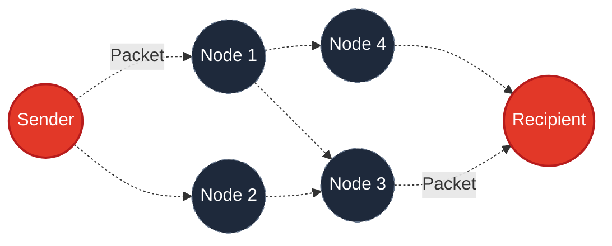

<div align="center">
  
<p></p>
  
  
  <h1>Bridgefy App: Community Network Research</h1>
  <p><b>Proprietary Mesh Routing • Decentralized Architecture</b></p>

  [](https://github.com/bridgefy/bridgefy-app/releases)
  [](https://github.com/bridgefy/bridgefy-app/releases)
  [](PRIVATE)
  [](#)
  
  <br>
  <a href="https://bridgefy.me">🌐 Official Website</a> • 
  <a href="https://github.com/bridgefy">💻 GitHub Repository</a>

</div>

<br>

> ⚠️ **RESTRICTED ACCESS NOTICE:** This repository serves as the distribution point for the Bridgefy Android Application. **This is NOT an open-source project.** The core SDK, cryptographic layers, and multi-hop routing algorithms are proprietary intellectual property of Bridgefy Inc.

---

## 🌍 DEPLOYMENT & RESEARCH INITIATIVE

This repository hosts the Android application for our **community-driven network research initiative**. Bridgefy's core technology has a proven track record of helping people stay connected when traditional networks fail.

> **Trusted by over 7 million users globally**, Bridgefy's offline messaging technology has been utilized during natural disasters, large-scale music festivals, and humanitarian crises. Our technology is recognized by global organizations for facilitating critical communication when Wi-Fi and cellular networks are down.

By using this application, you are directly contributing to network research. We collect essential telemetry (crash logs and routing metrics) to optimize decentralized communication algorithms for future crisis response.

---

## 📡 CORE CAPABILITIES

<table>
  <tr>
    <td width="50%" valign="top">
      <h3>⛓️ P2P Protocol</h3>
      <p>Direct, device-to-device encrypted packet transfer up to 100 meters. Immune to localized network outages and ISP bandwidth throttling.</p>
    </td>
    <td width="50%" valign="top">
      <h3>🕸️ Multi-Hop Mesh</h3>
      <p>Intelligent routing algorithms that allow payloads to traverse multiple intermediary devices, reaching targets far beyond the standard physical limits of Bluetooth.</p>
    </td>
  </tr>
  <tr>
    <td width="50%" valign="top">
      <h3>🎒 Store & Forward (Mule)</h3>
      <p>If a direct path is unavailable, packets are securely parked in the memory of mobile nodes. These "mules" physically carry the data across disconnected zones, deploying it upon detecting the target.</p>
    </td>
    <td width="50%" valign="top">
      <h3>📢 Broadcast Matrix</h3>
      <p>Cascading unicast transmission to all surrounding nodes instantly. Engineered for emergency localized alerts and high-priority public broadcasting.</p>
    </td>
  </tr>
</table>

---

## ⚙️ TOPOLOGY ARCHITECTURE

Below is a visualization of our proprietary Multi-Hop and Store & Forward routing behavior.



---

## 💻 INTEGRATE THE MESH (SDK)

Bridgefy provides enterprise access to our routing SDK for native iOS and Android environments. Provide your users with an indestructible communication layer.

```kotlin
// Bridgefy instance  
val bridgefy: Bridgefy

// Intialized mesh network
bridgefy.init(
      bridgefyApiKey: UUID,
      delegate: BridgefyDelegate?,
      logging: LogType = LogType.None,
    )

// Await mesh stabilization
bridgefy.start(  
       userId: UUID? = null,  
       propagationProfile: PropagationProfile = PropagationProfile.Standard,  
   )  

// Execute secure offline transmission
val messageId = bridgefy.send(  
    "Sample text!".toByteArray(Charsets.UTF_8),  
    TransmissionMode.P2P(peerID)  
)  
```
*To request SDK licensing and integration support, [our developer portal](https://developer.bridgefy.services/).*

---

## 💎 FUND THE INITIATIVE

Maintaining backend infrastructure and refining decentralized algorithms requires extensive resources. Support the advancement of offline communication:

<table>
  <tr>
    <td width="33%" align="center">
      <b>💳 FIAT (PayPal)</b><br><br>
      <a href="https://www.paypal.com/paypalme/bridgefy"></a>
    </td>
    <td width="33%" align="center">
      <b>🪙 BITCOIN (BTC)</b><br><br>
      <code>364WLk6ZLbTn...suvA5yeW</code>
    </td>
    <td width="34%" align="center">
      <b>🔷 ETHEREUM (ETH)</b><br><br>
      <code>0x287b7dA...FF524A1</code>
    </td>
  </tr>
</table>

---

## 📑 TECHNICAL FAQ

<details>
  <summary><b>Do I need internet to use Bridgefy?</b></summary>
  <blockquote>No. Bridgefy operates entirely offline using Bluetooth Low Energy (BLE). A singular, momentary internet connection is only required upon initial download to validate security certificates. Subsequent usage is 100% autonomous.</blockquote>
</details>

<details>
  <summary><b>Why are Location permissions mandatory?</b></summary>
  <blockquote>Android and iOS operating systems architecturally link Bluetooth Low Energy (BLE) scanning with Location Services to prevent malicious third-party tracking. We strictly adhere to these OS mandates to access the radio hardware. <b>We do not ingest, record, or track spatial GPS coordinates.</b></blockquote>
</details>

<details>
  <summary><b>Why is my message stuck?</b></summary>
  <blockquote>The packet is utilizing the <b>Store & Forward</b> protocol. There is currently no direct physical path to the recipient. The message is parked securely in memory and will automatically deploy the moment a valid network path is formed by a roaming device.</blockquote>
</details>

<details>
  <summary><b>Will the network operate in Airplane Mode?</b></summary>
  <blockquote>Yes, provided you manually re-enable Bluetooth after activating Airplane Mode. The application relies solely on the local Bluetooth radio stack to establish the mesh.</blockquote>
</details>

<details>
  <summary><b>What is the physical distance limit?</b></summary>
  A single point-to-point (P2P) hop can span approximately 100 meters (330 feet) depending on environmental interference (walls, trees). However, utilizing the Multi-Hop Mesh protocol, the total range is theoretically limitless as long as intermediary nodes are present to bridge the gap.
</details>

<details>
  <summary><b>Does continuous scanning drain battery?</b></summary>
  Bridgefy utilizes Bluetooth Low Energy (BLE), which is explicitly designed for minimal power consumption. While active meshing consumes more power than an idle state, our proprietary routing algorithms are heavily optimized to prevent excessive battery drain compared to standard Wi-Fi scanning.
</details>

<details>
  <summary><b>Is the network secure?</b></summary>
  Point-to-Point and Multi-Hop Mesh transmissions are secured via End-to-End Encryption (E2EE). Intermediary nodes passing your packet cannot decrypt the payload. Note: Broadcast Matrix messages are transmitted in plaintext, designed for public emergency alerts.
</details>

---

<div align="center">
  <sub>
    <b>LEGAL & COMPLIANCE DISCLAIMER</b><br>
    Bridgefy engineers the routing protocol; we do not intercept the payload. All telemetry transmitted across the Bridgefy ecosystem is strictly P2P and agnostic to the transport layer. We do not monitor, retain, or possess decryption keys for user-generated data. Operators assume full liability for compliance with local cryptographic and telecommunication statutes in their respective deployment jurisdictions.
  </sub>
</div>
